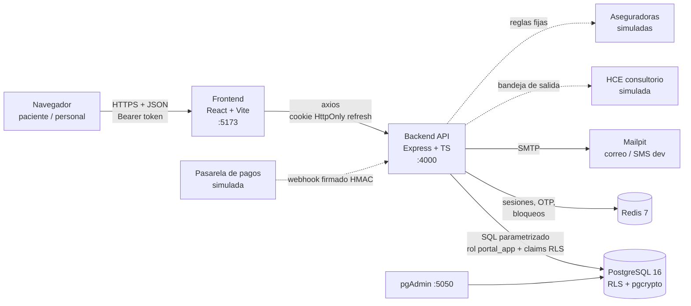
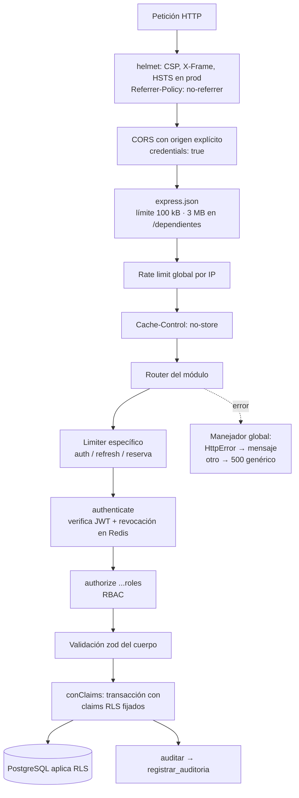
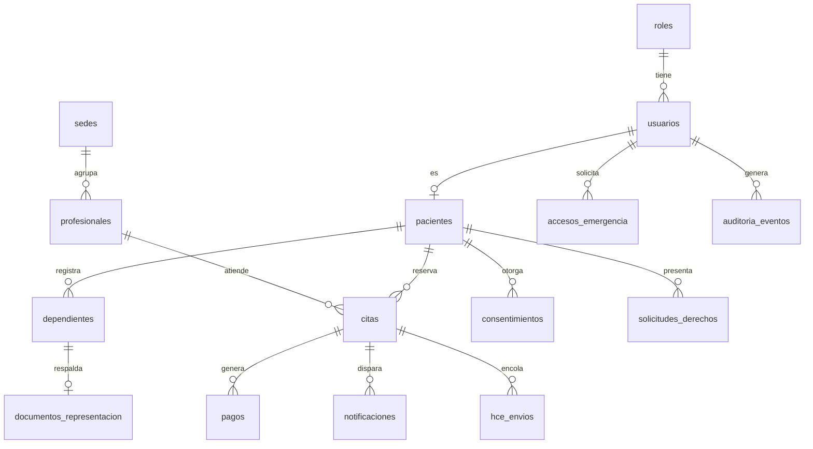
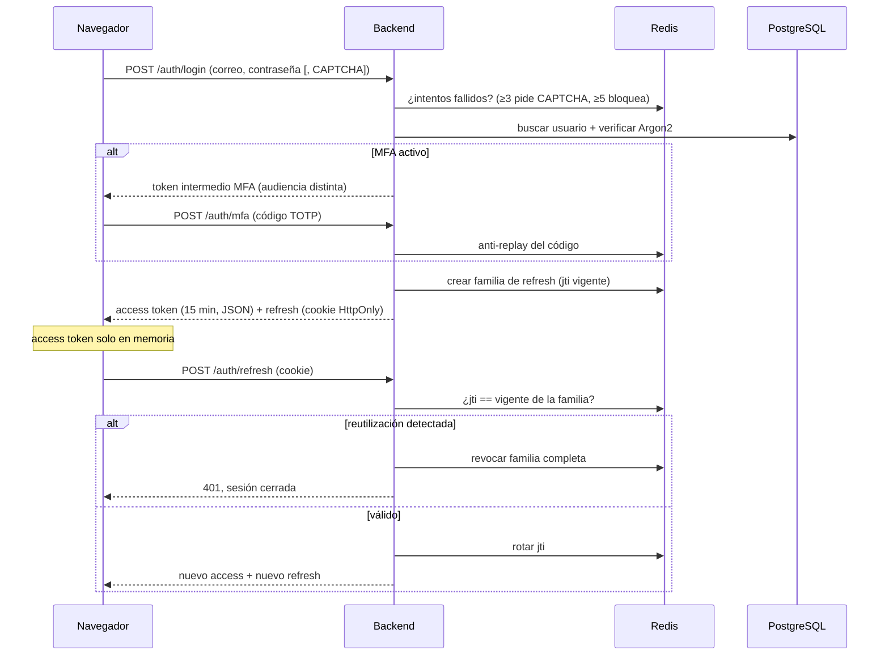

# Arquitectura del Portal de Citas Médicas

Resumen de cómo está construido el proyecto: componentes, capas, flujo de una petición, modelo de datos y controles de seguridad. Para instrucciones de ejecución y cuentas de prueba, ver [README.md](README.md).

---

## 1. Visión general

Es una aplicación web de tres capas, contenida en Docker:

| Capa | Tecnología | Responsabilidad |
|---|---|---|
| Presentación | React 18 + Vite + TailwindCSS + React Router | Interfaz por rol (SPA). Solo navegación: no decide permisos. |
| Lógica / API | Node.js 20 + Express + TypeScript | API REST modular. Autenticación, autorización por rol, validación, reglas de negocio, integraciones. |
| Datos | PostgreSQL 16 (con `pgcrypto` y RLS) | Persistencia, aislamiento de datos por fila, cifrado por campo, bitácora inmutable. |
| Estado efímero | Redis 7 | Sesiones (familias de refresh token), revocación de tokens, bloqueo por intentos, códigos OTP, CAPTCHA, anti-replay TOTP. |

Servicios de apoyo en desarrollo: **Mailpit** (bandeja SMTP para correos y SMS simulados) y **pgAdmin** (administración de la base).



---

## 2. Despliegue (docker-compose)

Todos los contenedores comparten la red `citas_net` (bridge). Definido en [docker-compose.yml](docker-compose.yml).

| Contenedor | Imagen | Puerto | Notas |
|---|---|---|---|
| `citas_postgres` | postgres:16-alpine | `127.0.0.1:5432` | Ejecuta los scripts de `database/` al crearse. Volumen `postgres_data`. |
| `citas_redis` | redis:7-alpine | `127.0.0.1:6379` | Con contraseña y persistencia AOF. Volumen `redis_data`. |
| `citas_pgadmin` | dpage/pgadmin4 | `127.0.0.1:5050` | Solo desarrollo. |
| `citas_mailpit` | axllent/mailpit | `127.0.0.1:8025` | Recibe correos y SMS simulados. |
| `citas_backend` | build `./backend` | `4000` | Espera a que Postgres y Redis estén *healthy*. |
| `citas_frontend` | build `./frontend` | `5173` | Sirve el build de producción con `vite preview`. |

Decisiones de despliegue relevantes para seguridad:

- Base de datos, Redis, pgAdmin y Mailpit **solo escuchan en `127.0.0.1`**: no quedan expuestos fuera del equipo.
- Las imágenes del backend y frontend aplican `apk upgrade`, **eliminan npm/npx** de la imagen final (vulnerabilidades detectadas por Trivy) y se ejecutan con `USER node` (sin root).
- Los secretos del compose son de desarrollo. Con `NODE_ENV=production` el backend **no arranca** si algún secreto falta o conserva su valor por defecto ([cifrado.ts](backend/src/config/cifrado.ts)).

---

## 3. Estructura del repositorio

```
Consultas_Medicas/
├── docker-compose.yml
├── database/                  Scripts SQL (se ejecutan en orden al crear la BD)
│   ├── 01_schema.sql            Tablas e índices
│   ├── 02_security_rls.sql      Row Level Security y funciones SECURITY DEFINER
│   ├── 03_triggers_audit.sql    Bitácora WORM con hash encadenado
│   ├── 04_seed_roles.sql        Catálogo de roles
│   ├── 05_rol_aplicacion.sql    Rol portal_app con privilegio mínimo
│   └── migraciones/             Migraciones idempotentes para bases existentes
├── backend/
│   └── src/
│       ├── app.ts               Punto de entrada: middlewares, rutas, arranque
│       ├── config/              database, redis, jwt, cifrado, correo, sms
│       ├── middlewares/         auth, rbac, rate-limit, security-headers
│       ├── modules/             Un módulo por dominio funcional (ver §4.2)
│       ├── utils/               validaciones (zod), contraseñas, TOTP, HMAC, http
│       └── scripts/             seed.ts, verificaciones.ts
├── frontend/
│   └── src/
│       ├── App.tsx              Enrutador con carga diferida de páginas
│       ├── sesion.tsx           Contexto de sesión y guardas por rol
│       ├── services/api.ts      Cliente axios, manejo del access token
│       ├── pages/               Una pantalla por función de cada rol
│       ├── components/          Layout, selector de horario, panel de pago…
│       └── utils/               fechas, validaciones del lado cliente
└── pruebas/
    ├── flujos-seguridad.js      Pruebas de punta a punta contra la API
    └── carga.k6.js              Prueba de carga con k6
```

---

## 4. Backend

### 4.1 Pipeline de una petición

[app.ts](backend/src/app.ts) monta los middlewares en este orden:



Puntos clave:

- **`authenticate`** ([auth.ts](backend/src/middlewares/auth.ts)) verifica firma, expiración y audiencia del JWT y luego consulta en Redis si su `jti` está revocado. Si Redis no responde, **falla cerrado** (503).
- **`authorize(...roles)`** ([rbac.ts](backend/src/middlewares/rbac.ts)) es el control de acceso por rol a nivel de ruta.
- **`conClaims`** ([database.ts](backend/src/config/database.ts)) abre una transacción y fija con `set_config(..., true)` los claims del usuario (`rol`, `paciente_id`, `sede_id`, `profesional_id`, `aseguradora`, `usuario_id`). Las políticas RLS los leen. Como el ámbito es local a la transacción, los claims **no se filtran** a otra petición que reutilice la conexión del pool.
- Al arrancar, el backend comprueba que su rol de BD **no sea superusuario ni tenga BYPASSRLS**; en producción aborta si lo es.

### 4.2 Módulos

Cada carpeta en [backend/src/modules/](backend/src/modules/) es un router Express montado en su prefijo:

| Prefijo | Módulo | Funciones principales | Roles |
|---|---|---|---|
| `/auth` | auth | Registro, login, CAPTCHA, MFA TOTP, verificación de correo, refresh/logout, perfil, consentimientos, exportar mis datos, baja | Todos |
| `/agenda` | agenda | Catálogo y horarios (públicos), reservar, confirmar, cancelar, reprogramar, agenda de sede y de médico, llegada y atención | Paciente, recepción, médico |
| `/cobertura` | cobertura | Registrar póliza (cifrada), verificar cobertura, solicitudes de la aseguradora | Paciente, aseguradora |
| `/pagos` | pagos | Iniciar pago, webhook firmado de la pasarela, cobro en caja, conciliación | Paciente, recepción, contabilidad |
| `/dependientes` | dependientes | Alta de dependientes con documento cifrado y su verificación | Paciente, recepción |
| `/derechos` | derechos | Solicitudes de derechos ARCO del paciente y respuesta del DPD | Paciente, DPD |
| `/auditoria` | auditoria | Consulta de la bitácora, verificación de la cadena de hashes, política de conservación | Oficial de seguridad, DPD |
| `/seguridad` | seguridad | Incidentes, alertas, revisión de accesos del personal, decisión sobre accesos de emergencia | Oficial de seguridad, DPD |
| `/soporte` | soporte | Estado operativo, solicitud y uso de acceso de emergencia (*break-glass*) | Soporte |
| `/admin` | admin | Alta, edición y desactivación de sedes y profesionales | Administrador |

Servicios internos (sin rutas propias):

- **notificaciones** ([programador.ts](backend/src/modules/notificaciones/programador.ts)): tareas periódicas con `setInterval` para recordatorios 24 h, política de conservación diaria y desactivación de cuentas del personal inactivas.
- **hce** ([servicio.ts](backend/src/modules/hce/servicio.ts)): bandeja de salida (*outbox*) con reintentos hacia la historia clínica electrónica. Solo envía identificadores de cita y paciente y la hora; la cita nunca depende de que la HCE responda.

### 4.3 Configuración

| Archivo | Contenido |
|---|---|
| [config/database.ts](backend/src/config/database.ts) | Pool `pg`, `conClaims`, `auditar` |
| [config/redis.ts](backend/src/config/redis.ts) | Revocación, familias de refresh, bloqueo de cuenta, OTP, CAPTCHA, anti-replay TOTP |
| [config/jwt.ts](backend/src/config/jwt.ts) | Emisión y verificación de access (15 min), refresh y token intermedio de MFA, con audiencias separadas |
| [config/cifrado.ts](backend/src/config/cifrado.ts) | Lectura de secretos y verificación en producción |
| [config/correo.ts](backend/src/config/correo.ts), [config/sms.ts](backend/src/config/sms.ts) | Envío por SMTP (Mailpit) y SMS (proveedor o Mailpit) |

---

## 5. Base de datos

### 5.1 Modelo de datos

Tablas principales ([01_schema.sql](database/01_schema.sql)):



Otras tablas: `incidentes`, `tokens_revocados`. El personal se vincula a su ámbito con `usuarios.sede_id`, `usuarios.profesional_id` o `usuarios.aseguradora`.

Estados de una cita: `retenida → en_verificacion → (sin_cobertura | pendiente_pago) → confirmada → (atendida | ausente)`, y en cualquier momento `cancelada` o `expirada`.

### 5.2 Roles de base de datos

| Rol | Uso | Privilegios |
|---|---|---|
| `citas_app` | Dueño de las tablas. Solo migraciones y `seed`. | Superusuario: se salta RLS. **La API nunca lo usa.** |
| `portal_app` | Conexión de la API ([05_rol_aplicacion.sql](database/05_rol_aplicacion.sql)) | `NOSUPERUSER NOBYPASSRLS`. Sin `DELETE` en citas ni pagos. Sin escritura directa en la bitácora. |

### 5.3 Row Level Security

[02_security_rls.sql](database/02_security_rls.sql) activa RLS en las tablas con datos personales y define políticas por rol que leen los claims de la transacción. Ejemplos:

- Un **paciente** solo ve y modifica sus citas, pagos, dependientes y consentimientos.
- **Recepción** ve y actualiza solo citas y pagos de **su sede**.
- Un **médico** ve solo **sus** citas y los pacientes que tiene agendados.
- Una **aseguradora** ve solo a **sus afiliados** y autoriza sus solicitudes.
- **Soporte** solo lee la agenda de una sede si tiene un **acceso de emergencia aprobado y vigente**.
- El rol interno **`sistema`** lo usan el webhook firmado y las tareas programadas.

Sin claims, las tablas protegidas no devuelven filas. Así, un error en la lógica del backend no basta para que un usuario vea datos de otro.

Las operaciones que necesitan saltarse RLS de forma controlada (registrar auditoría, encolar envíos a la HCE, aplicar la política de conservación) están en funciones `SECURITY DEFINER` con parámetros acotados.

### 5.4 Bitácora WORM

[03_triggers_audit.sql](database/03_triggers_audit.sql):

- Cada evento guarda `hash_anterior` y `hash_actual = sha256(campos | hash_anterior)`, formando una **cadena**. Un `advisory lock` evita que dos inserciones concurrentes rompan el orden.
- Triggers que **prohíben UPDATE, DELETE y TRUNCATE**.
- Solo se escribe con `registrar_auditoria(...)`.
- `verificar_cadena_auditoria()` recalcula todos los hashes y detecta alteraciones o enlaces rotos (expuesto en `GET /auditoria/verificar-cadena`).

### 5.5 Datos cifrados

| Dato | Protección |
|---|---|
| Contraseña | Argon2 |
| Número de póliza | `pgp_sym_encrypt` (pgcrypto) con `POLIZA_KEY`; la interfaz muestra solo los 4 últimos dígitos |
| Secreto TOTP | `pgp_sym_encrypt` con `MFA_KEY` |
| Documento de representación de dependientes | `pgp_sym_encrypt` con `DOCUMENTOS_KEY`; se elimina tras la verificación |
| Cédula / pasaporte | HMAC-SHA256 con `HMAC_SECRET` (permite detectar duplicados sin guardar el número) |
| Códigos OTP | Solo su hash SHA-256 en Redis, 15 min, máx. 5 intentos |

---

## 6. Frontend

- **SPA con React Router** ([App.tsx](frontend/src/App.tsx)). Cada página se carga con `lazy()`.
- **Sesión** ([sesion.tsx](frontend/src/sesion.tsx)): contexto con el usuario actual; la guarda `<Solo roles=[...]>` redirige según el rol. Cada rol tiene una pantalla de inicio (`INICIO_POR_ROL`). Esto es **solo navegación**: el backend vuelve a validar el rol en cada petición.
- **Cliente HTTP** ([services/api.ts](frontend/src/services/api.ts)):
  - El access token vive **solo en memoria** (no en `localStorage`), para que un XSS no pueda leerlo de ahí.
  - El refresh token va en cookie `HttpOnly; SameSite=Strict`.
  - Un interceptor renueva el token ante un 401 y reintenta una vez. Las renovaciones se serializan, porque dos refresh simultáneos parecerían reutilización y el servidor revocaría la sesión.
- **CSP** inyectada en `index.html` al hacer el build ([vite.config.js](frontend/vite.config.js)): `script-src 'self'` y `connect-src` limitado a la API.

Páginas por rol:

| Rol | Páginas |
|---|---|
| Paciente | Catalogo, Reserva, MisCitas, Perfil, Dependientes, SolicitudesDerechos, VerificarCorreo |
| Recepción | AgendaPersonal, VerificarDependientes |
| Médico | AgendaPersonal |
| Aseguradora | Afiliados |
| Administrador | AdminCatalogo |
| Oficial de seguridad | Auditoria, Incidentes, Accesos |
| DPD | Auditoria, SolicitudesDerechos, Incidentes, Conservacion |
| Contabilidad | Conciliacion |
| Soporte | Soporte |

---

## 7. Flujos principales

### 7.1 Autenticación y sesión



### 7.2 Reserva, cobertura y pago

1. El paciente consulta el catálogo y los horarios (públicos) y reserva → cita `retenida` (con límite de reservas por IP).
2. Se verifica la cobertura con la aseguradora (simulada) → `en_verificacion` → la aseguradora autoriza o rechaza.
3. Con cobertura, la cita pasa a `pendiente_pago`. El copago se paga:
   - **en línea**: la pasarela notifica por `POST /pagos/webhook`, autenticado con firma **HMAC-SHA256** (`WEBHOOK_SECRET`), y se procesa con claims `sistema`;
   - **en caja**: recepción registra el cobro en su sede.
4. La cita queda `confirmada`. Se encola el aviso a la HCE y se envía la notificación; 24 h antes se manda el recordatorio.
5. El día de la cita, recepción marca la llegada y el médico la marca como `atendida` o `ausente`.

Cada paso queda en la bitácora mediante `auditar(...)`.

### 7.3 Acceso de emergencia (*break-glass*)

Soporte solicita acceso a la agenda de una sede → el oficial de seguridad aprueba o rechaza → si se aprueba, RLS permite la lectura solo durante la vigencia → soporte cierra el acceso. Todo queda auditado.

---

## 8. Resumen de controles de seguridad por capa

| Capa | Controles |
|---|---|
| Red / despliegue | Servicios internos solo en `127.0.0.1`; contenedores sin root; imágenes parcheadas y sin npm; secretos obligatorios en producción |
| Transporte / cabeceras | Helmet (CSP, frame-ancestors, HSTS en prod), `no-store`, `Referrer-Policy: no-referrer`, CORS con origen explícito |
| Entrada | Límite de tamaño de cuerpo; validación estricta con zod (correo, cédula ecuatoriana, teléfono, fechas, contraseña) |
| Abuso | Rate limit global y por endpoint; bloqueo progresivo de cuenta; CAPTCHA adaptativo; respuesta de login con hash ficticio para no revelar si la cuenta existe |
| Identidad | Argon2; rechazo de contraseñas filtradas; MFA TOTP con anti-replay; verificación de correo con OTP |
| Sesión | Access token de 15 min en memoria; refresh rotativo en cookie HttpOnly con detección de reutilización; revocación por `jti` |
| Autorización | RBAC en cada ruta **y** RLS en PostgreSQL con rol sin privilegios |
| Datos | Cifrado por campo (pgcrypto), HMAC de identificaciones, consultas parametrizadas, política de conservación |
| Trazabilidad | Bitácora WORM con hash encadenado y verificación de integridad |
| Integraciones | Webhook con firma HMAC; HCE con datos mínimos y outbox con reintentos |

---

## 9. Integraciones simuladas en local

| Integración | Comportamiento en desarrollo |
|---|---|
| Aseguradoras | Reglas fijas en el módulo `cobertura` |
| Pasarela de pagos | Simulador (`/pagos/simulador`) que dispara el mismo webhook firmado que el real |
| SMS | Sin `SMS_API_URL`, llegan a Mailpit como `<telefono>@sms.local` |
| HCE | Sin `HCE_URL`, el envío se registra en el log del backend |
| CAPTCHA | Desafío aritmético propio guardado en Redis |

---

## 10. Pruebas y verificación

| Herramienta | Qué valida |
|---|---|
| [scripts/verificaciones.ts](backend/src/scripts/verificaciones.ts) | Comprobaciones contra la BD (V01, V03, V04, V07, V15, V16): no se guardan números de tarjeta, aislamiento entre aseguradoras y entre pacientes por RLS, inmutabilidad y cadena de la bitácora, identificaciones y pólizas ilegibles en un volcado |
| [pruebas/flujos-seguridad.js](pruebas/flujos-seguridad.js) | Flujos de punta a punta contra la API: login con TOTP del personal, reserva → cobertura → pago por webhook firmado o en caja, aislamiento entre aseguradoras, contraseña filtrada, CAPTCHA tras 3 fallos, derechos del titular, incidentes, acceso de emergencia con aprobación de una segunda persona, conciliación |
| [pruebas/carga.k6.js](pruebas/carga.k6.js) | Prueba de carga con k6 |
| Gitleaks, Semgrep, Trivy | Secretos en el repositorio, análisis estático y vulnerabilidades de dependencias e imágenes |
